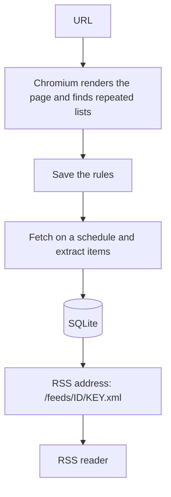

<p align="center"></p>

# FeedLantern

**English** · [简体中文](README.zh-CN.md)

[Website & documentation](https://jaaayden.github.io/feedlantern/en/) · [Releases](https://github.com/Jaaayden/feedlantern/releases)

[](https://github.com/Jaaayden/feedlantern/actions/workflows/ci.yml)

**Turn any web page into an RSS feed.** Self-hosted and visual, with your data on your own server.

Enter a URL and FeedLantern finds the list of articles; if it guesses wrong, click on the page to adjust. Once saved, a background job keeps it up to date and you get a standard RSS address for any reader.

## Features

- **Web page to RSS**: matches titles, links, images, summaries and dates automatically. Pages are rendered in a real Chromium, so dynamic pages, lazy loading and cookie sign-ins work.
- **Visual adjustment**: when detection isn't right, click the content on the page or edit the CSS selectors. The preview uses exactly the same rules as background fetches.
- **RSS translation**: translate existing RSS/Atom feeds into Simplified Chinese, Traditional Chinese, English, Japanese or Korean, as a translation-only or bilingual feed. Use the free Google channel (experimental), DeepL or any OpenAI-compatible API (including local models such as Ollama), with caching, rate-limit backoff and retries.
- **Bulk management**: add up to 100 URLs at once; pause, resume, refresh, delete or change settings for many feeds together; export OPML for any reader, or import OPML to create translated feeds.
- **Standard, readable RSS**: readers get clean RSS 2.0 (with refresh interval and thumbnails). Open a feed address in a browser and you see a readable page with a copy button and recent items instead of raw XML.
- **PubMed searches**: follow new papers by keyword, journal, author or affiliation with a builder modelled on PubMed's Advanced Search, read through NCBI's official E-utilities within NCBI's rate limits, optionally translated.
- **Bundles**: combine several feeds into one address (RSS, Atom or JSON Feed), merged by time, with sources noted and each link once — no extra fetching.
- **Multiple users**: administrators create accounts; everyone manages their own feeds, cookies and notifications, and administrators can step into any workspace.
- **Observability**: every feed has a fetch log (30 days by default). Repeated failures alert you through Bark, webhooks, ntfy or Telegram (several at once), deduplicated. When a site redesign makes items drop or fields disappear, FeedLantern flags that the rules may have stopped working, and you can re-detect and compare in one click.
- **Safe defaults**: cookies are stored encrypted; each RSS address has its own rotatable key; private, loopback and cloud metadata addresses are blocked by default; the Chromium sandbox stays on.
- **Backup & migration**: encrypted full backups, restore onto another server, and lightweight configuration export/import with only the feed rules.
- **Languages**: English and Simplified Chinese. The language is saved per account, so every device you sign in on agrees; without a choice it follows your browser. Adding a language takes one message file.
- **Bounded size**: logs, events and caches are capped, so the database stays a stable size.

## Quick start

You need Linux (amd64 or arm64), [Docker Engine](https://docs.docker.com/engine/install/) and the [Compose plugin](https://docs.docker.com/compose/install/linux/); allow about 2 GB of memory. Create a directory, download two configuration files and start:

```sh
mkdir feedlantern
cd feedlantern
curl -fLO https://raw.githubusercontent.com/Jaaayden/feedlantern/main/docker-compose.yml -fLO https://raw.githubusercontent.com/Jaaayden/feedlantern/main/seccomp_profile.json
docker compose up -d --wait
docker compose logs feedlantern
```

Open [http://127.0.0.1:4321](http://127.0.0.1:4321) and create the administrator with the one-time setup code from the log. There is no default account or password.

`seccomp_profile.json` keeps the Chromium sandbox working — don't delete it or switch to privileged mode. Data lives in a Docker named volume, which `docker compose down` does not remove.

## Upgrading

Run in the deployment directory; the data volume and configuration stay as they are:

```sh
docker compose pull feedlantern
docker compose up -d --wait feedlantern
```

Export an encrypted backup in Settings → Backup & migration before upgrading. See [Maintenance](doc/maintenance.md) (Chinese) for caveats and rollback.

## Going public

By default FeedLantern listens on the loopback address only. To serve a domain, put Nginx with HTTPS in front of it on the host — see the [Nginx guide](doc/nginx.md) (Chinese). Behind a reverse proxy, always add the proxy's address to Trusted reverse proxies in Settings → Server & network; otherwise login rate limiting treats everyone as one client. See the [configuration reference](doc/en/configuration.md).

## How it works



A React + Vite web app, a Fastify API, SQLite storage and Playwright driving Chromium. Previews, batch detection and background refreshes share one extraction path, so what you see is what you get.

## Scope

Works with ordinary DOM lists, dynamically rendered pages and pages behind a cookie sign-in. Multiple pages can be collected through a “Next page” link or button, a URL page template or a “Load more” button (one page by default, up to 10, with a pause between pages). Not supported yet: full-article fetching, complete collection of infinite scroll, picking inside iframes, closed Shadow DOM, canvas content, and interactive sign-ins or CAPTCHAs. Scheduled updates need the server to keep running. Details are in the [user guide](doc/en/user-guide.md#scope).

## Documentation

| I want to… | Read |
| --- | --- |
| Deploy, set up HTTPS, configure | [Deployment](doc/en/deployment.md) · [Nginx](doc/nginx.md) (Chinese) · [Configuration](doc/en/configuration.md) |
| Use FeedLantern day to day | [User guide](doc/en/user-guide.md) |
| Back up, migrate, upgrade, manage database size | [Backup & migration](doc/backup-and-migration.md) · [Maintenance](doc/maintenance.md) (Chinese) |
| Fix a problem | [Troubleshooting](doc/troubleshooting.md) (Chinese) |
| Manage it from scripts or AI agents | [Agent CLI & MCP](doc/agent.md) (Chinese) |
| Contribute | [Development & API](doc/development.md) (Chinese) · [CONTRIBUTING](CONTRIBUTING.md) · [SECURITY](SECURITY.md) |

The full index is in the [documentation index](doc/README.md); changes are in the [CHANGELOG](CHANGELOG.md).

## Local development

You need Node.js 24 and pnpm:

```sh
pnpm install --frozen-lockfile
pnpm browser:install
pnpm dev
```

## License

[MIT](LICENSE).
